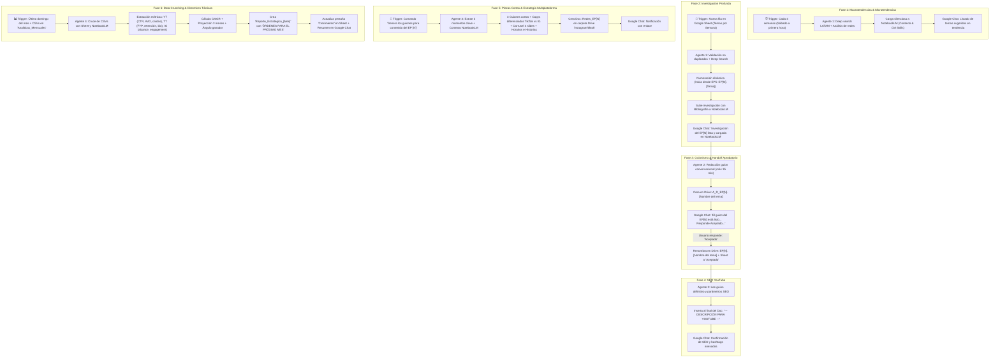

# Protocolo de Operación y Colaboración: "La Cantera" 🎙️

Este documento define el protocolo estricto, la arquitectura de agentes y el flujo de trabajo integral de 6 fases para la producción y el crecimiento de **"La Cantera"** (podcast y ecosistema de contenido sobre masculinidad saludable en México y Latinoamérica).

---

## 👥 Equipo de Agentes y Asignación de Fases

| Agente | Nombre | Rol Principal | Fases a Cargo |
| :--- | :--- | :--- | :--- |
| **Agente 1** | 🕵️‍♂️ Investigador y Estratega | Analista de Tendencias e Investigador Académico | **Fase 1** (Análisis de Nicho) y **Fase 2** (Investigación Profunda) |
| **Agente 2** | ✍️ Guionista Principal | Guionista de Podcast y Storyteller | **Fase 3** (Creación de Guion y Aprobación) |
| **Agente 3** | 🚀 Especialista SEO y Content Manager | Estratega de Distribución y Copywriter Corto | **Fase 4** (SEO YouTube) y **Fase 5** (Contenido Corto y Redes) |
| **Agente 4** | 📊 Analista de Crecimiento Predictivo | Científico de Datos y Analista de Algoritmos | **Fase 6** (Auditoría Mensual y Proyecciones) |

---

## 🔄 Pipeline Operativo de 6 Fases



---

## 📋 Especificación Detallada de Cada Fase

### Fase 1: Análisis de Nicho y Actualización de Contexto
* **Disparador:** Automático, cada 4 semanas (sábado a primera hora).
* **Insumo:** Palabras clave predefinidas enfocadas en México y LATAM (*masculinidad saludable, machismo, salud mental masculina, corrientes de pensamiento, estudios sociológicos/psicológicos recientes*).
* **Proceso:**
  1. *Macrotendencias:* Búsqueda profunda sobre noticias, ensayos y estudios psicológicos/sociológicos recientes.
  2. *Microtendencias:* Análisis de contenido en YouTube, TikTok e Instagram (formatos compartidos, ángulos de debate, horarios/días empíricos).
  3. *Actualización Base de Conocimiento:* Carga silenciosa en el cuaderno central de NotebookLM (datos, métricas, contexto de redes).
  4. *Curaduría:* Destilación en lista concisa de títulos/temas viables con alta resonancia.
* **Entregable:** Lista de temas sugeridos + NotebookLM actualizado.
* **Mensaje a Google Chat:**
  > `"El análisis mensual del nicho está completo y la base de conocimiento actualizada. Aquí tienes la lista de temas en tendencia sugeridos para este mes: [Listado de temas]. Listos para que elijas y los pegues en tu Google Sheet."`

---

### Fase 2: Investigación Profunda y Base de Conocimiento
* **Disparador:** Detección de nueva fila en Google Sheets ("Temas por Semana").
* **Insumo:** Texto de la celda ingresada + ID del cuaderno NotebookLM de La Cantera.
* **Proceso:**
  1. *Validación:* Comprobar que no exista duplicado en la columna de temas previos.
  2. *Investigación:* Deep Search web priorizando fuentes confiables.
  3. *Consolidación:* Reporte estructurado con sección final obligatoria de **"Bibliografía"** con enlaces.
  4. *Numeración dinámica:* Leer número de último episodio y sumar +1 (**iniciando la numeración a partir del número 5: `EP5`**).
  5. *Formateo de Título:* `EP[Número]. [Nombre del tema]`.
* **Entregable:** Archivo de texto/markdown con la investigación y bibliografía.
* **Destino:** Subir como nueva fuente a NotebookLM y enviar ping por Google Chat:
  > `"Investigación del EP[Número] lista y cargada en NotebookLM"`

---

### Fase 3: Creación de Guion y Flujo de Aprobación
* **Disparadores:**
  * *Inicial:* Detección de la nueva fuente cargada en NotebookLM.
  * *Aprobación:* Detección de la palabra exacta `"Aceptado"` en Google Chat.
* **Insumo:** Contenido de la fuente en NotebookLM + directrices de tono (charla reflexiva, no formal, cercana, un solo locutor, máx 35 min de lectura).
* **Proceso:**
  1. *Redacción:* Guion estructurado para máx 35 min de locución.
  2. *Creación de Archivo:* Carpeta predefinida en Google Drive con nomenclatura: `A_R_EP[Número]. [Nombre del tema]`.
  3. *Espera de Aprobación.*
  4. *Post-Aprobación:* Al recibir `"Aceptado"`, renombra el archivo eliminando el prefijo `A_R_` (quedando `EP[Número]. [Nombre del tema]`) y cambia el valor de la columna `"Guion"` en Google Sheets a `"Aceptado"`.
* **Mensaje a Google Chat:**
  > `"El guion del [EP Número] está listo para tu revisión aquí: [Link de Drive]. Responde 'Aceptado' para finalizarlo".`

---

### Fase 4: Creación de Descripción SEO para YouTube
* **Disparador:** Detección de la palabra `"Aceptado"` en Google Chat (arranque automático).
* **Insumo:** Texto completo del guion aprobado en Drive + parámetros SEO de masculinidad.
* **Proceso:**
  1. Identificar conceptos clave y términos de búsqueda orgánica.
  2. Redactar descripción optimizada (gancho, resumen rico en keywords, hashtags estratégicos).
  3. Insertar al final del Google Doc del guion bajo el separador:
     ```markdown
     --- DESCRIPCIÓN PARA YOUTUBE ---
     ```
* **Mensaje a Google Chat:**
  > `"La descripción con SEO y los hashtags han sido generados y anexados exitosamente al final del guion del [EP Número]."`

---

### Fase 5: Contenido Corto y Estrategia de Redes
* **Disparador:** Comando manual en Google Chat: `"Genera los guiones para contenido del EP [Número]"` o `"Extrae los clips"`.
* **Insumo:** Documento final del guion semanal + contexto de algoritmos y tendencias en NotebookLM (Fase 1).
* **Proceso:**
  1. *Selección:* Extraer los 3 momentos de mayor impacto reflexivo.
  2. *Guiones de video corto:* 3 guiones (gancho fuerte, desarrollo conciso, llamada a la acción).
  3. *Copys diferenciados:*
     * **TikTok:** Optimizado para búsqueda/SEO y retención rápida.
     * **Instagram:** Optimizado para interacción, guardados y comentarios.
  4. *Carrusel:* Texto para carrusel de 4 diapositivas enfocado en el concepto central.
  5. *Estrategia:* Mejores días/horarios empíricos de publicación, dinámicas para historias (encuestas/preguntas) y tips de comunidad.
* **Entregable y Destino:** Nuevo documento guardado en la carpeta de Drive `instagram/tiktok` titulado `Redes_EP[Número]`.
* **Mensaje a Google Chat:**
  > `"Los 3 guiones, copys, carrusel y sugerencias de estrategia del episodio están listos en la carpeta de redes. [Link]"`

---

### Fase 6: Analítica Exhaustiva y Proyección Predictiva (Data Crunching)
* **Disparador:** Último domingo de cada mes, usuario sube CSVs de YT Studio, TikTok Analytics y Meta Business Suite a `Analiticas_Mensuales` en Drive y envía: `"Ejecuta la auditoría de crecimiento del mes"`.
* **Insumos:** Archivos CSV, Google Sheet maestro y cuaderno de NotebookLM.
* **Proceso y Variables:**
  * **YouTube:** CTR de miniaturas, AVD (Average View Duration), retención al 1:00 min, timestamps de caída, tráfico (Búsqueda vs Sugeridos), conversión espectador ➔ suscriptor.
  * **TikTok:** % de reproducción completa, tiempo medio vs duración total, distribución FYP vs Perfil, conversión a clics en link de bio, ratio Guardados + Compartidos vs Likes.
  * **Instagram:** Alcance seguidores vs no seguidores, engagement por formato (Reel vs Carrusel), interacción en historias (stickers, abandonos, DMs), visitas al perfil post-Reel.
  * **Diagnóstico Predictivo:** Tasa CMGR, proyección a 3 meses e identificación del "Ángulo Ganador" del mes.
* **Entregables:**
  1. Documento `Reporte_Estrategico_[Mes]` en Google Drive con la sección obligatoria:
     ```markdown
     ### ÓRDENES PARA EL PRÓXIMO MES
     [Directrices operativas y correcciones técnicas para el Investigador y el Guionista]
     ```
  2. Actualización de pestaña `"Crecimiento"` en Google Sheet.
* **Mensaje a Google Chat:**
  > `"Auditoría mensual finalizada. Crecimiento general: YT [X%], TT [X%], IG [X%]. El formato ganador del mes fueron los carruseles. Revisa el diagnóstico completo y las sugerencias de ajuste de guion aquí: [Link de Docs]."`
